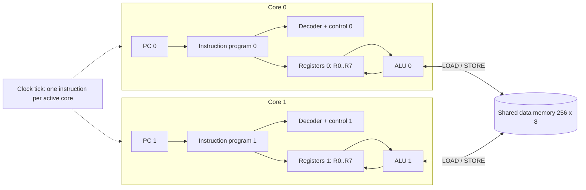
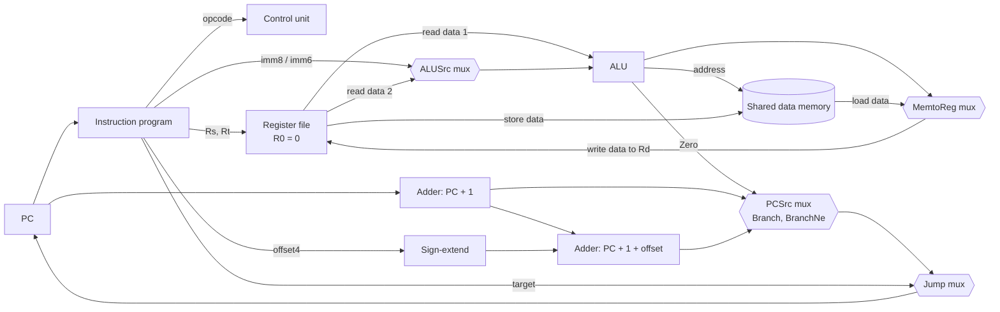

# Architecture and datapath

## Dual-core block diagram

Each core owns its PC, instruction program, decoder, control unit, register file and ALU (PDF). Only the data memory is shared (PDF).

## Single-core datapath (the lecture's single-cycle datapath, 8-bit version)

**How one instruction flows**

1. *Fetch:* the PC selects one 16-bit word from the core's program, and an adder computes PC + 1. The PC is a list index, so the next address is PC + 1, not MIPS PC + 4 (implementation choice).
2. *Decode/control:* the opcode in bits [15:12] drives the control unit. The register fields feed the register file.
3. *Execute:* the ALUSrc mux chooses ALU input B: register Rt (0) or the immediate (1).
4. *Memory:* LOAD/STORE use the ALU result as the memory address.
5. *Writeback:* the MemtoReg mux chooses the ALU result (0) or the loaded byte (1), and the value is written to Rd (masked to 8 bits). A write to R0 is discarded.
6. *Next PC:* PC + 1. For a branch whose Zero test passes, the target is PC + 1 + sign-extended offset. For J, it is the absolute target.

## Control signal table (compare with the lecture's MIPS table)

`X` = don't care (stored as `None` in `ControlSignals`).

| Signal | R-type (8 ALU ops) | LOAD | STORE | HALT | LOADI | NOT | SLT | SLTI | BEQ | BNE | J | Lecture value for lw / sw / beq |
|---|---|---|---|---|---|---|---|---|---|---|---|---|
| RegDst | 1 | 1 | X | X | 1 | 1 | 1 | 1 | X | X | X | lw 0, sw X, beq X |
| ALUSrc | 0 | 1 | 1 | X | 1 | X | 0 | 1 | 0 | 0 | X | lw 1, sw 1, beq 0 |
| MemtoReg | 0 | 1 | X | X | 0 | 0 | 0 | 0 | X | X | X | lw 1, sw X, beq X |
| RegWrite | 1 | 1 | 0 | 0 | 1 | 1 | 1 | 1 | 0 | 0 | 0 | lw 1, sw 0, beq 0 |
| MemRead | 0 | 1 | 0 | 0 | 0 | 0 | 0 | 0 | 0 | 0 | 0 | lw 1, sw 0, beq 0 |
| MemWrite | 0 | 0 | 1 | 0 | 0 | 0 | 0 | 0 | 0 | 0 | 0 | lw 0, sw 1, beq 0 |
| Branch | 0 | 0 | 0 | 0 | 0 | 0 | 0 | 0 | 1 | 1 | 0 | lw 0, sw 0, beq 1 |
| BranchNe | 0 | 0 | 0 | 0 | 0 | 0 | 0 | 0 | 0 | 1 | 0 | *added for BNE* |
| Jump | 0 | 0 | 0 | 0 | 0 | 0 | 0 | 0 | 0 | 0 | 1 | *textbook extension for j* |
| ALUOp | operation | ADD | ADD | X | ADD | NOT | SLT | SLT | SUB | SUB | X | lw/sw Add, beq Subtract |

The LOAD, STORE and BEQ columns match the lecture's lw, sw and beq columns. The one exception is RegDst for LOAD.

**Where we differ from MIPS, and why** (forced by the 16-bit ISA in `docs/ISA.md`, not by the PDF):

- **RegDst:** MIPS `lw` writes `rt` and R-type writes `rd`, so a mux chooses between them. Here every instruction that writes a register names it in bits [11:9], so RegDst is 1 whenever RegWrite is 1.
- **ALUOp:** MIPS sends a 2-bit ALUOp plus the `funct` field to a separate ALU-control unit. Our 4-bit opcode names the operation directly.
- **Base register R0:** the imm8 instructions (LOAD, STORE, LOADI) have no room for an Rs field, so their base register is R0. R0 is hard-wired to zero, like `$zero`. LOAD/STORE compute `R0 + address`, exactly like `lw $t0, 100($zero)`. LOADI computes `R0 + imm8`, like `addi $t0, $zero, 5`.
- **BranchNe:** the lecture table has `beq` only. BNE uses the same column with the Zero test inverted: taken = Zero XOR BranchNe. This is the only signal this project adds.
- **Jump:** this is the textbook's extension of the single-cycle datapath for `j`. Our target is an absolute 8-bit instruction index.
- **Branch target:** PC + 1 + offset, the index version of MIPS PC + 4 + (offset << 2). There is no shift, because the PC counts instructions, not bytes.
- **SLT/SLTI** compare unsigned values (like `sltu`), because all data is unsigned 8-bit.
- **NOT** is unary, so ALU input B is unused and ALUSrc is X.

**Scope:** these diagrams show logical blocks, not a timing-accurate circuit. There is no pipeline, cache, flag register or interrupt hardware. Each core owns its state; only data memory is shared.
