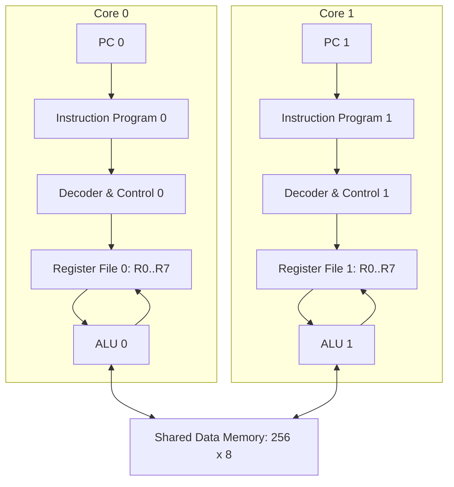

# Simplified architecture and datapath (stage 01: expand and explain)

Single core simplified path:

`PC → instruction program → decode/control → register read → ALU (or memory access) → register writeback → next PC`

**How one instruction flows (stage 01).** *Fetch:* the PC selects one 16-bit word from the core's instruction program; the PC is a list index, so it later advances by 1 (PDF: 16-bit instructions; PC+1 is an implementation choice replacing MIPS PC+4). *Decode/control:* the decoder splits the word into opcode `[15:12]` and register/address fields, and the control unit turns the opcode into the signals from the lecture's single-cycle control table (see below) — e.g. `XOR R3,R1,R2` gives `RegDst=1, ALUSrc=0, MemtoReg=0, RegWrite=1, ALUOp=XOR`, `LOAD R2,[1]` gives `RegDst=1, MemtoReg=1, RegWrite=1, MemRead=1`, `STORE` gives only `MemWrite=1`, and `HALT` gives all write/read signals 0. *Register read and ALU selection:* Rs and Rt are read from that core's own register file and `alu_op` picks one of the eight operations. *Writeback:* when `reg_write=1` the ALU result (or the loaded memory byte) is written into Rd, masked to 8 bits. Execution itself is built in stage 02; stage 01 only provides the encoding, register file, and control signals.

### Control signal table (compare with the lecture's MIPS table)

`X` = don't care (stored as `None` in `ControlSignals`).

| Signal | R-type (8 ALU ops) | LOAD | STORE | HALT | LOADI (bonus) | NOT (bonus) | SLT (st. 07) | SLTI (st. 07) | BEQ (st. 07) | BNE (st. 07) | J (st. 07) | MIPS lecture value for lw / sw / beq |
|---|---|---|---|---|---|---|---|---|---|---|---|---|
| RegDst | 1 | 1 | X | X | 1 | 1 | 1 | 1 | X | X | X | lw 0, sw X, beq X |
| ALUSrc | 0 | X | X | X | 1 | X | 0 | 1 | 0 | 0 | X | lw 1, sw 1, beq 0 |
| MemtoReg | 0 | 1 | X | X | 0 | 0 | 0 | 0 | X | X | X | lw 1, sw X, beq X |
| RegWrite | 1 | 1 | 0 | 0 | 1 | 1 | 1 | 1 | 0 | 0 | 0 | same |
| MemRead | 0 | 1 | 0 | 0 | 0 | 0 | 0 | 0 | 0 | 0 | 0 | same |
| MemWrite | 0 | 0 | 1 | 0 | 0 | 0 | 0 | 0 | 0 | 0 | 0 | same |
| Branch | 0 | 0 | 0 | 0 | 0 | 0 | 0 | 0 | 1 | 1 | 0 | beq 1 |
| BranchNe (added for BNE) | 0 | 0 | 0 | 0 | 0 | 0 | 0 | 0 | 0 | 1 | 0 | not in MIPS table |
| Jump (added for J) | 0 | 0 | 0 | 0 | 0 | 0 | 0 | 0 | 0 | 0 | 1 | not in this MIPS table |
| ALUOp | the opcode's operation | X | X | X | PASS | NOT | SLT | SLT | SUB | SUB | X | lw/sw Add, beq Subtract |

Why some values differ from MIPS (implementation choices forced by the ISA in `docs/ISA.md`, not by the PDF):

- **RegDst:** MIPS `lw` writes `rt` and R-type writes `rd`, so a mux picks between them. Here both R-type Rd and LOAD Rd sit in bits `[11:9]`, so RegDst is 1 for every register-writing instruction and that mux has only one real input.
- **ALUSrc and ALUOp for LOAD/STORE:** MIPS computes `base + offset` in the ALU, so it needs the immediate (ALUSrc=1) and an Add. Our LOAD/STORE carry an absolute 8-bit address that goes straight to data memory, so the ALU is idle and both signals are X.
- **ALUOp for R-type:** MIPS sends a 2-bit ALUOp plus the `funct` field to a separate ALU-control unit. Our 4-bit opcode directly names one of the eight operations, so ALUOp carries that name.
- **Bonus LOADI (stage 05, revised):** LOADI travels the lecture's datapath: immediate → ALUSrc mux (ALUSrc=1) → ALU → MemtoReg=0 → register write, the same path MIPS `ori $t0, $zero, imm` takes. The ALU uses a small internal function **PASS** (result = input B). PASS is not an instruction; it is needed because LOADI has no Rs field (bits [8:6] belong to imm8), so there is no register to OR the immediate with. (An earlier version used a separate `ImmToReg` writeback input; it was removed so no extra datapath input is needed.)
- **Bonus NOT (stage 05):** unary, so ALU input B is unused (ALUSrc = X); otherwise it behaves like an R-type ALU instruction.
- **Branch / PCSrc (stage 07 extension):** BEQ/BNE use exactly the lecture's beq column (ALUSrc=0, ALUOp=Subtract, Branch=1), and the ALU's zero result drives the PCSrc mux: taken when Zero=1 for BEQ, or Zero=0 for BNE (the extra `BranchNe` signal). Target = PC + 1 + offset, the index-based analogue of MIPS PC + 4 + (offset << 2). `Jump=1` selects the absolute J target. Otherwise next PC = PC + 1 (unchanged after HALT). Before stage 07 there were no branches and the next PC was always PC + 1.
- **R0 is hard-wired to zero (stage-07 revision):** like MIPS `$zero`, the core discards any instruction's write to R0, so `BEQ Rx, R0, ...` tests for zero directly. It is implemented in the core's writeback rather than in the register file, so the protected stage-01 test that sets R0 directly still passes.
- **LOADI and SLTI share the immediate path (ALUSrc=1):** the immediate becomes ALU input B, the same role ALUSrc=1 plays in MIPS. The only difference is the field: LOADI uses imm8 (bits [8:1]) and SLTI uses imm6 (bits [5:0]). SLT/SLTI compare **unsigned** values (like MIPS `sltu`), matching this ISA's unsigned 8-bit data.

**Scope:** diagrams describe logical blocks, not a timing-accurate electronic circuit. Every core owns its state; only data memory is shared. Claude must add a short explanation at stage 01, with signal examples, but must not add pipeline/cache hardware. The only control-flow hardware is the stage-07 next-PC mux (branch target / jump target / PC + 1).
