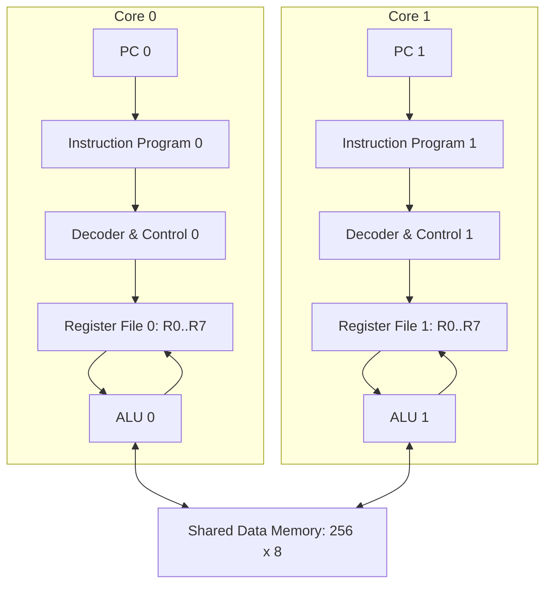

# Simplified architecture and datapath (stage 01: expand and explain)

Single core simplified path:

`PC → instruction program → decode/control → register read → ALU (or memory access) → register writeback → next PC`

**How one instruction flows (stage 01).** *Fetch:* the PC selects one 16-bit word from the core's instruction program; the PC is a list index, so it later advances by 1 (PDF: 16-bit instructions; PC+1 is an implementation choice replacing MIPS PC+4). *Decode/control:* the decoder splits the word into opcode `[15:12]` and register/address fields, and the control unit turns the opcode into signals — e.g. `XOR R3,R1,R2` gives `reg_write=1, mem_read=0, mem_write=0, alu_op=XOR`, `LOAD R2,[1]` gives `reg_write=1, mem_read=1`, `STORE` gives only `mem_write=1`, and `HALT` gives all zeros. *Register read and ALU selection:* Rs and Rt are read from that core's own register file and `alu_op` picks one of the eight operations. *Writeback:* when `reg_write=1` the ALU result (or the loaded memory byte) is written into Rd, masked to 8 bits. Execution itself is built in stage 02; stage 01 only provides the encoding, register file, and control signals.

**Scope:** diagrams describe logical blocks, not a timing-accurate electronic circuit. Every core owns its state; only data memory is shared. Claude must add a short explanation at stage 01, with signal examples, but must not add pipeline/cache/branch hardware.
