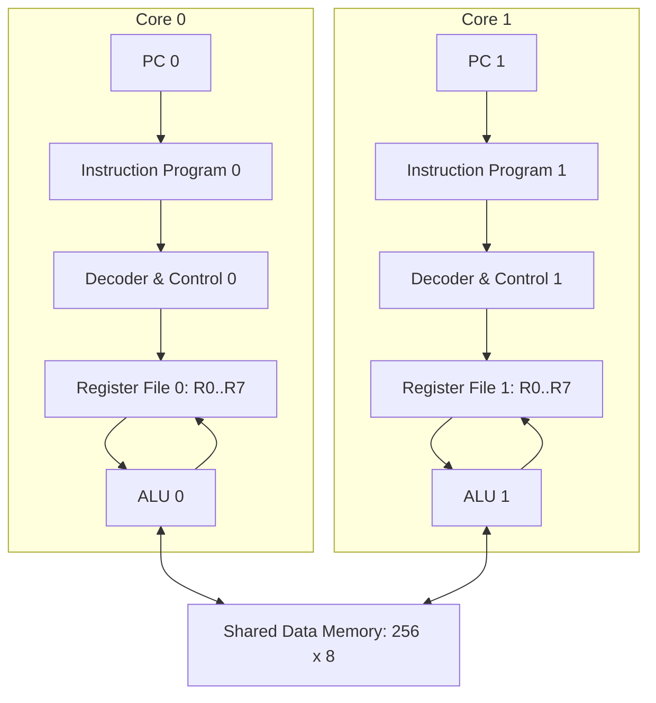

# Simplified architecture and datapath (stage 01: expand and explain)

Single core simplified path:

`PC → instruction program → decode/control → register read → ALU (or memory access) → register writeback → next PC`

**How one instruction flows (stage 01).** *Fetch:* the PC selects one 16-bit word from the core's instruction program; the PC is a list index, so it later advances by 1 (PDF: 16-bit instructions; PC+1 is an implementation choice replacing MIPS PC+4). *Decode/control:* the decoder splits the word into opcode `[15:12]` and register/address fields, and the control unit turns the opcode into the signals from the lecture's single-cycle control table (see below) — e.g. `XOR R3,R1,R2` gives `RegDst=1, ALUSrc=0, MemtoReg=0, RegWrite=1, ALUOp=XOR`, `LOAD R2,[1]` gives `RegDst=1, MemtoReg=1, RegWrite=1, MemRead=1`, `STORE` gives only `MemWrite=1`, and `HALT` gives all write/read signals 0. *Register read and ALU selection:* Rs and Rt are read from that core's own register file and `alu_op` picks one of the eight operations. *Writeback:* when `reg_write=1` the ALU result (or the loaded memory byte) is written into Rd, masked to 8 bits. Execution itself is built in stage 02; stage 01 only provides the encoding, register file, and control signals.

### Control signal table (compare with the lecture's MIPS table)

`X` = don't care (stored as `None` in `ControlSignals`).

| Signal | R-type (8 ALU ops) | LOAD | STORE | HALT | LOADI (bonus) | NOT (bonus) | MIPS lecture value for lw / sw |
|---|---|---|---|---|---|---|---|
| RegDst | 1 | 1 | X | X | 1 | 1 | lw 0, sw X |
| ALUSrc | 0 | X | X | X | X | X | lw 1, sw 1 |
| MemtoReg | 0 | 1 | X | X | X | 0 | lw 1, sw X |
| ImmToReg (added for LOADI) | 0 | 0 | 0 | 0 | 1 | 0 | not in MIPS table |
| RegWrite | 1 | 1 | 0 | 0 | 1 | 1 | same |
| MemRead | 0 | 1 | 0 | 0 | 0 | 0 | same |
| MemWrite | 0 | 0 | 1 | 0 | 0 | 0 | same |
| ALUOp | the opcode's operation | X | X | X | X | NOT | lw/sw Add |

Why some values differ from MIPS (implementation choices forced by the ISA in `docs/ISA.md`, not by the PDF):

- **RegDst:** MIPS `lw` writes `rt` and R-type writes `rd`, so a mux picks between them. Here both R-type Rd and LOAD Rd sit in bits `[11:9]`, so RegDst is 1 for every register-writing instruction and that mux has only one real input.
- **ALUSrc and ALUOp for LOAD/STORE:** MIPS computes `base + offset` in the ALU, so it needs the immediate (ALUSrc=1) and an Add. Our LOAD/STORE carry an absolute 8-bit address that goes straight to data memory, so the ALU is idle and both signals are X.
- **ALUOp for R-type:** MIPS sends a 2-bit ALUOp plus the `funct` field to a separate ALU-control unit. Our 4-bit opcode directly names one of the eight operations, so ALUOp carries that name.
- **Bonus LOADI / ImmToReg (stage 05):** the immediate is neither an ALU result nor a memory byte, so the writeback mux gets a third input selected by `ImmToReg=1` (it overrides MemtoReg). This mirrors the extra writeback path textbook MIPS extensions add for `lui`; the ALU stays idle.
- **Bonus NOT (stage 05):** unary, so ALU input B is unused (ALUSrc = X); otherwise it behaves like an R-type ALU instruction.
- **No Branch / PCSrc:** branches are excluded (`docs/COURSE_BOUNDARY.md`), so the next PC is always PC+1, or unchanged after HALT.

**Scope:** diagrams describe logical blocks, not a timing-accurate electronic circuit. Every core owns its state; only data memory is shared. Claude must add a short explanation at stage 01, with signal examples, but must not add pipeline/cache/branch hardware.
